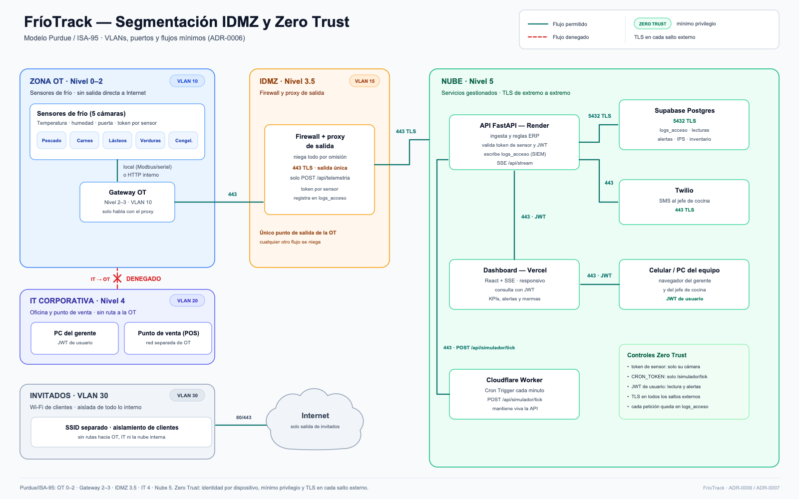

# Seguridad IT/OT y diseño del SOC

## Contexto y amenazas

FríoTrack decide si un lote se mueve, se marca en riesgo o se da de baja con las temperaturas de cinco cámaras; ese historial es la evidencia de una inspección. La red plana del restaurante es el punto débil: sensores, terminal de pagos, PC del gerente y Wi-Fi de clientes comparten el mismo espacio, y un equipo comprometido puede intentar hablar con los sensores o robarse un token.

Tres amenazas: **fuerza bruta de tokens** contra `POST /api/telemetria`; **token de sensor robado** usado desde otra IP, donde el token es válido pero el origen no; y **lecturas manipuladas** para esconder un compresor caído o una puerta abierta. Las tres buscan que el sistema decida con datos falsos; el módulo combina segmentación, identidad y un SOC mínimo que registra, detecta y responde.

## Diseño IDMZ y Zero Trust

La red se separa con **Purdue / ISA-95** adaptado a un restaurante. La operación (OT) no comparte red con la administración (IT), y todo lo que sale pasa por la **IDMZ** (nivel 3.5). Ninguna conexión se confía por estar "adentro": cada flujo se autoriza por identidad y necesidad —mínimo privilegio—. Eso es Zero Trust en un negocio pequeño.

| Zona | Nivel Purdue | VLAN | Qué contiene |
|---|---|---|---|
| OT | 0–2 | 10 | Sensores de las cinco cámaras |
| Gateway OT | 2–3 | 10 | Laptop o Raspberry que junta las lecturas |
| IDMZ | 3.5 | 15 | Firewall y proxy de salida |
| IT corporativa | 4 | 20 | PC del gerente y punto de venta |
| Invitados | — | 30 | Wi-Fi de clientes, aislada de lo interno |
| Nube | 5 | — | API en Render, Postgres en Supabase, dashboard en Vercel, Worker de Cloudflare y Twilio |

Los flujos permitidos son pocos y explícitos:

| Origen | Destino | Puerto | Para qué |
|---|---|---|---|
| Sensores | Gateway OT | Local | Lecturas por Modbus/serial o HTTP interno |
| Gateway OT | Proxy de la IDMZ | 443 | Reenviar lecturas |
| Proxy de la IDMZ | API en Render | 443 TLS | Solo `POST /api/telemetria` |
| API | Supabase Postgres | 5432 TLS | Base de datos |
| API | Twilio | 443 | SMS al jefe de cocina |
| Celular o PC | Dashboard y API | 443 | Consulta con JWT |
| Worker de Cloudflare | API | 443 | `POST /api/simulador/tick` cada minuto |
| Wi-Fi de invitados | Internet | 80/443 | Nada interno |

Todo lo demás se niega. **IT no puede entrar a OT** (flujo denegado): la PC del gerente y el punto de venta no tienen ruta a los sensores, así que un equipo infectado no llega a la operación. La OT no acepta conexiones entrantes; solo inicia el flujo al gateway y al proxy. Las VLANs microsegmentan y el proxy reduce la salida a un destino y un endpoint.

Controles: token por sensor (solo su cámara), `CRON_TOKEN` (solo `/api/simulador/tick`), JWT (lectura y alertas) y `logs_acceso` con IP, ruta, estado y sujeto; TLS en los saltos externos y firewall que niega por omisión.

En el prototipo las VLANs y el firewall son de diseño; el código implementa tokens, roles, TLS y logs. El diagrama es la referencia para instalar un router con VLANs, la única inversión de red real.



*Figura 1. Zonas, VLANs y flujos del diseño IDMZ / Zero Trust (fuente vectorial en `security/diagramas/idmz.svg` y versión editable en `idmz.drawio`).*

## Reglas SIEM

Las reglas están en **Sigma** (YAML) para convertirlas a Splunk, Elastic, Sentinel o Wazuh. El prototipo usa tres:

| Regla | Archivo | Condición | Umbral | Severidad | Acción |
|---|---|---|---|---|---|
| Fuerza bruta de tokens | `security/siem/fuerza-bruta-tokens.yml` | `401` o `403` en `/api/telemetria` o `/api/simulador/tick` desde la misma IP | 10 o más en 5 minutos | Alta (`high`) | Bloquear la IP 60 minutos y alertar |
| Token de sensor desde IP desconocida | `security/siem/token-ip-desconocida.yml` | `credencial = sensor`, `status = 202` en `/api/telemetria` y `ip_origen` fuera de la lista de confianza | 1 evento | Alta (`high`) | Revocar el token del sensor y alertar |
| Lecturas imposibles | `security/siem/lecturas-imposibles.yml` | Cambio de más de 8 °C en 60 segundos o menos en la misma cámara | 1 evento | Media (`medium`) | Marcar las lecturas como sospechosas y alertar |

La primera cubre también el cron por un `CRON_TOKEN` viejo. La segunda castiga el origen, no el token. La tercera usa `recibida_en` (hora del servidor), no el `ts` del sensor. Los umbrales son de prototipo; cada YAML documenta sus falsos positivos.

## Detector SIEM

El detector es un **CLI independiente** (`security/detector/`). No corre dentro de FastAPI: se ejecuta con `python -m security.detector`, lee la base y escribe alertas; puede correr a mano, con `--intervalo 60` o como tarea.

Consulta `logs_acceso` (última hora) y `lecturas` (diez minutos), evalúa las tres reglas y ejecuta la acción. La evaluación está separada de Postgres (`RepositorioPostgres`) para probarla sin red. Opciones: `--dry-run`, `--ips-permitidas`/`IPS_RESTAURANTE` y `--bloqueo-minutos`.

Dedupe: no repite una alerta con el mismo `regla_id` y `detalle->>'clave'` en una hora. Nunca bloquea IPs de confianza: si la fuerza bruta viene de `127.0.0.1` o `::1`, avisa pero no corta dashboard ni simulador.

Acciones: `alertas_seguridad` (severidad, IP, detalle, acción), `ips_bloqueadas` (`ON CONFLICT` extiende el bloqueo), `sensores.activo=false` y `lecturas.sospechosa=true`. La API revisa `ips_bloqueadas` al inicio de cada petición y responde `403`; la caché de 15 s hace visible el bloqueo en ese plazo.

## Demo de ataque y respuesta

La demo usa `127.0.0.2` para no bloquear `127.0.0.1` (dashboard y simulador). En macOS se crea una vez por arranque:

```bash
sudo ifconfig lo0 alias 127.0.0.2 up
```

Con la API local arriba y la base migrada, se lanza el ataque:

```bash
PYTHONPATH=. backend/.venv/bin/python security/ataque.py --intentos 15 --espera 20
```

El script manda 15 `POST /api/telemetria` con tokens `token-falso-N`; la API responde `401`. Con `--espera 20` manda una extra para ver el bloqueo. Luego se ejecuta el detector:

```bash
PYTHONPATH=. backend/.venv/bin/python -m security.detector --once
```

El resultado esperado es una alerta **alta** por fuerza bruta desde `127.0.0.2`, el bloqueo de esa IP durante **60 minutos** y, pasados los 15 segundos de caché del middleware, un **403** para la petición extra. El dashboard en `127.0.0.1` sigue intacto porque está en la lista de IPs de confianza. Antes conviene correr `--dry-run`.

Si no se puede crear el alias (por ejemplo, sin permisos de administrador), la alternativa es levantar una segunda instancia de la API y atacar desde la IP LAN. El detector se apunta a esa base con `--database-url` y se ajusta `--ips-permitidas` para incluir la IP del dashboard y no la del atacante. El flujo es el mismo: 401, alerta, bloqueo y 403.

## Limitaciones y siguientes pasos

El detector **no es un SIEM completo**: no interpreta YAML Sigma genérico (implementa las tres condiciones en Python con los mismos IDs), no correlaciona fuentes ni tiene retención, tableros o gestión de casos.

Las ventanas y umbrales son de prototipo (10 intentos en 5 minutos, 8 °C en 60 segundos, bloqueo de 60 minutos, dedupe de una hora) y hay que calibrarlos; un token viejo o un reacomodo pueden dar falsos positivos.

El bloqueo es local: `ips_bloqueadas` lo consulta esta API, no el router ni un WAF; en producción hay que empujarlo al firewall. En la demo depende del alias de loopback; sin él, usar la IP LAN y la segunda instancia.

Las VLANs y la IDMZ son diseño; el prototipo no configura un switch administrado. Lo implementado es tokens, JWT, roles, TLS, logs y respuesta; el diagrama es la referencia para desplegar la red.

Con esos límites, el módulo evita que una lectura falsa pase desapercibida y permite reaccionar antes de perder producto.
